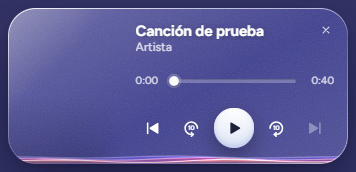
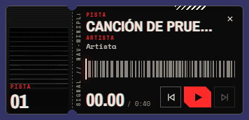
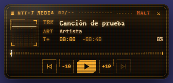
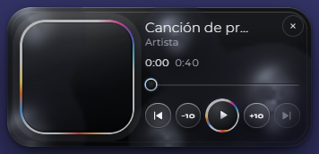

# Nav Miniplayer

[English](README.en.md) · **Español**

[](https://github.com/eduulopezs/nav-miniplayer/actions/workflows/ci.yml)
[](https://github.com/eduulopezs/nav-miniplayer/actions/workflows/codeql.yml)
[](LICENSE)


Un minirreproductor flotante para el audio y el vídeo de cualquier pestaña de Chrome o Edge, siempre encima de tus otras ventanas.
Play/pausa, ±10 s, pista anterior y siguiente, barra de progreso y cuatro diseños, sin salir de lo que estás haciendo.

<p align="center">
  
  
  
  
</p>

## Instalar
Mismo código para Chrome y Edge (requiere la versión 116 o superior).

**Desde GitHub Releases** (cuando haya una versión publicada):
1. Descarga el `.zip` de la última versión en [Releases](https://github.com/eduulopezs/nav-miniplayer/releases) y descomprímelo.
2. Abre `chrome://extensions` (o `edge://extensions`), activa **Modo de desarrollador** y pulsa **Cargar descomprimida** (en Edge, **Cargar desempaquetada**).
3. Elige la carpeta descomprimida (la que contiene `manifest.json`).

**Desde el código:**
```
git clone https://github.com/eduulopezs/nav-miniplayer.git
cd nav-miniplayer
npm run zip        # opcional: genera dist/nav-miniplayer-<versión>.zip
```
Carga la carpeta del repositorio como se indica arriba. Para usarla no hace falta compilar nada ni instalar dependencias.

La primera vez se abre **Ajustes**: activa **Acceso a los sitios** para que el reproductor se cargue solo en todas las páginas (permiso opcional; las pestañas abiertas lo reciben al concederlo). Sin ese acceso, el clic en el icono o un atajo lo cargan en la pestaña activa, pero anterior/siguiente pueden no funcionar en sitios que registran sus controles antes (el reproductor te avisa de que recargues la página para activarlos). Al reproducir audio/vídeo, pulsa el icono de la extensión para abrir el minirreproductor.

## Uso
- Play/pausa, ±10 s, anterior/siguiente (usa Media Session del sitio; en YouTube/Spotify Web funcionan).
- Detecta `<audio>`/`<video>` de la página, `new Audio()` sin insertar y medios dentro de shadow DOM (abierto o cerrado), tanto si se llama a `play()` como si arrancan solos con `autoplay`. Si suenan varios elige el que tiene sonido, después el último que sonó y después el más largo; ignora los vídeos de fondo silenciados y en bucle. También los de iframes (incluidos los sin insertar), con un agente sin interfaz en cada subframe. Fuera de alcance: Media Session dentro de un iframe, y medios creados en un documento ajeno (`createElement` de otro `document`).
- La barra de progreso de cada diseño busca al pulsar o arrastrar y muestra el tiempo bajo el puntero.
- **Clic derecho en la tarjeta**: menú con volumen, velocidad (0.5x a 3x), salto (5, 10, 15 o 30 s), diseño y copiar el enlace en el minuto actual (con tiempo en YouTube y Vimeo; en el resto, el enlace de la página). La **rueda** sobre la tarjeta cambia el volumen en pasos de 5 % y el volumen se recuerda por sitio. Volumen y velocidad solo actúan sobre medios del DOM (no sobre los de iframes ni los sin insertar). En la ventana flotante con marco no hay menú.
- **Carátula difuminada**: un clic en la carátula la difumina (otro clic la devuelve; también con Intro o Espacio) y la preferencia se recuerda. En los layouts medianos y grandes hay además un **regulador de volumen** junto al botón de silencio, que usa el mismo volumen recordado por sitio.
- **Miniatura al pasar por la barra** (YouTube): sobre la barra de progreso aparece la miniatura del storyboard del vídeo con su tiempo, si la tarjeta tiene hueco. Las hojas las descarga el service worker, solo desde ytimg.com.
- **Atajos** (se pueden cambiar en `chrome://extensions/shortcuts`): Alt+Shift+M mostrar/ocultar, Alt+Shift+P play/pausa, Alt+Shift+, y Alt+Shift+. retroceder y avanzar; pista anterior y siguiente sin tecla por defecto.
- Tamaño: redimensiona la ventana desde cualquier borde o esquina; el contenido se adapta en tiempo real (pastilla, fila, compacto, portada o panorámico según el espacio).
- Aparece solo al pulsar el icono de la extensión (clic izquierdo; otro clic la cierra): una ventana flotante con marco (Document Picture-in-Picture, Chrome/Edge 116+; la barra de título nativa no es eliminable desde una extensión), siempre encima aunque minimices el navegador, con la tarjeta completa y sus botones. Si el navegador no permite el PiP de documento, se abre la ventana aparte como respaldo.
- Teclado: con Tab se enfoca el reproductor; **Espacio** o **K** play/pausa, **←/→** ±10 s, **Esc** lo oculta. El progreso y la pista se anuncian a lectores de pantalla, y con "reducir movimiento" activado los títulos largos se truncan en vez de desplazarse.

### Ventana aparte (todas las pestañas)
Clic derecho en el icono → **Abrir ventana aparte (todas las pestañas)** (o el atajo "Abrir la ventana aparte", sin tecla por defecto). Es una ventana de la extensión, sin depender de un gesto en la página ni de Picture-in-Picture, con los mismos diseños y layouts: arriba hay una pastilla por pestaña con sonido (icono y título), el botón ↗ lleva a la pestaña elegida y los controles, la barra de progreso y el teclado (Espacio, ←/→) actúan sobre ella. Por defecto muestra la que suena. Recuerda su posición y tamaño. Mientras está cerrada, las pestañas no informan de nada.

### Diseños
Clic derecho en el icono → **Diseño** para cambiar el aspecto en caliente (se aplica a la ventana abierta):
- **Glassware**: cristal translúcido con cintas de color que siguen la música y paleta sacada de la carátula.
- **Noir**: negro y rojo señal, carátula en blanco y negro, código de barras y relieve de espectro.
- **Terminal CRT**: fósforo ámbar con curvatura de tubo, líneas de escaneo y ecualizador de texto.
- **Liquid Metal**: metal cromado con mercurio en movimiento y anillo de color.

Para que el visualizador siga el audio real de la pestaña, marca **Visualizador con el audio real de la pestaña** en el menú del icono; la captura empieza con el clic en el icono y el navegador muestra su indicador. Sin ella, el visualizador es simulado.

La tarjeta se adapta a su tamaño (pastilla, fila, compacto, portada, panorámico) con container queries. Las fuentes se cargan desde la propia extensión. La interfaz está en español e inglés (`_locales/`).

## Compatibilidad

✅ probado a mano (aparece la tarjeta, play/pausa y ±10 s actúan sobre el medio) · ☑️ asumido, sin probar todavía.

| Sitio | Estado | Notas |
|---|---|---|
| YouTube | ✅ | Con un anuncio delante, la tarjeta sigue al medio que suena en ese momento. |
| YouTube Music | ☑️ | Rechaza Chromium automatizado, hay que probarlo en un Chrome normal. |
| Spotify Web | ☑️ | Necesita sesión y DRM. |
| SoundCloud | ☑️ | |
| Twitch | ☑️ | |
| Vimeo incrustado | ☑️ | Iframe; cubierto por los tests e2e con iframes locales. |
| Vídeo de noticias | ☑️ | |

## Permisos y privacidad
La extensión no tiene servidor propio ni telemetría. Los ajustes y el volumen por sitio se guardan en `chrome.storage.local`.

| Permiso | Para qué |
|---|---|
| `activeTab`, `scripting` | Cargar el reproductor en la pestaña activa al pulsar el icono o un atajo. |
| `storage` | Guardar ajustes, diseño y volumen por sitio. |
| `contextMenus` | Menú del icono (diseño, ventana aparte, visualizador). |
| `tabCapture`, `offscreen` | Solo si activas el visualizador con el audio real; el audio sigue sonando igual y el navegador muestra su indicador de captura. |
| `<all_urls>` (opcional) | Acceso a los sitios, solo si lo concedes en **Ajustes**, para cargar el reproductor automáticamente en todas las páginas. |

Las únicas peticiones de red las hace el service worker: carátulas (solo URL públicas `http(s)`, sin cookies, con tope de tamaño) y hojas de miniaturas de YouTube. Detalle en [SECURITY.md](SECURITY.md) (modelo de amenazas y límites conocidos) y [PRIVACY.md](PRIVACY.md).

## Estructura
```
manifest.json
_locales/                        textos en es y en
design/tokens.json               fuente única de tokens (primitivos y semánticos por diseño)
src/
  background/
    service-worker.js            clic en el icono, menú contextual, descarga de carátulas y relevo de mensajes de iframes
    sessions.js                  sesiones de todas las pestañas, órdenes de la ventana aparte y su apertura
    injection.js                 registro dinámico e inyección de los scripts de contenido
    migrate.js                   migración del almacenamiento entre versiones de esquema
    net-guard.js                 reglas de red para carátulas (URL permitidas y detección de imagen por bytes)
  page/media-session-bridge.js   mundo de la página: captura los manejadores de Media Session y vigila los medios sin insertar o en shadow DOM
  content/
    config.js                    constantes y claves de almacenamiento
    util.js                      clamp y formato de tiempo
    media.js                     medios remotos (del puente y de iframes) y política de selección
    frame-agent.js               agente sin interfaz en cada iframe: informa al marco superior y ejecuta sus órdenes
    tokens.js                    GENERADO desde design/tokens.json (variables CSS y colores de la paleta)
    styles.js                    CSS del reproductor; solo usa var(--token)
    fonts.js                     carga de las fuentes incluidas
    viz.js                       motor del visualizador (espectro y forma de onda)
    menu.js                      menú del clic derecho sobre la tarjeta
    storyboard.js                miniatura al pasar por la barra (YouTube)
    skins/                       los cuatro diseños: glass, noir, crt, metal
    player.js                    DOM, estado, ventana con marco y teclado
  offscreen/                     documento que analiza el audio capturado
  options/                       página de Ajustes
  window/                        ventana aparte (todas las pestañas)
  fonts/                         fuentes woff2 y LICENSES.txt
scripts/                         zip.mjs, build-tokens.mjs, contrast.mjs, check.mjs, security.mjs y smoke.mjs
tests/e2e/                       pruebas e2e con Playwright
docs/screenshots/                capturas de este README
```
Los módulos de `content/` se cargan en el orden de `injection.js` y comparten el espacio `__NMP`.

### Tokens de diseño
Los colores viven en `design/tokens.json` en tres capas: **primitivos** (`lavender-300`), **semánticos por diseño** (`ac`, `fg`, `track`, `play-bg`…) y, en el CSS, los componentes que los consumen con `var(--token)`. Los valores aceptan `{primitivo}` o `{primitivo}@alfa`.

- `npm run tokens` regenera `src/content/tokens.js` (no lo edites a mano; `npm test` falla si está desactualizado).
- `npm run contrast` audita el contraste WCAG de texto/fondo de cada diseño; `npm test` lo ejecuta con `--strict`, así que un token que baje de su mínimo rompe la verificación (Glass es aproximado: su fondo es translúcido).

## Desarrollo
Requiere Node 22 o superior.
- `npm test`: verificación rápida sin navegador (manifest, sintaxis, tokens, contraste, seguridad y humo).
- `npm run e2e`: pruebas en Chromium con la extensión cargada. La primera vez: `npm ci` y `npx playwright install chromium`. Las capturas de los diseños quedan en `tests/e2e/__shots__/` (ignorada por git); las de este README son copias en `docs/screenshots/`.
- `npm run zip`: genera `dist/nav-miniplayer-<versión>.zip`.
- GitHub Actions (`.github/workflows/ci.yml`) ejecuta en cada PR dos jobs separados: las verificaciones rápidas (`npm test` y `npm run zip`, que sube el zip como artefacto) y las pruebas e2e en Chromium.

La versión vive solo en el campo `version` de `manifest.json`.

## Contribuir
Las contribuciones son bienvenidas: lee [CONTRIBUTING.md](CONTRIBUTING.md). Los cambios de cada versión están en [CHANGELOG.md](CHANGELOG.md). Para avisar de una vulnerabilidad, mira [SECURITY.md](SECURITY.md). Estado de accesibilidad en [ACCESSIBILITY.md](ACCESSIBILITY.md).

## Licencia y créditos
[MIT](LICENSE). Las fuentes incluidas (JetBrains Mono, Archivo Narrow, Space Mono, Figtree, Syne, VT323 y Montserrat) se distribuyen bajo la SIL Open Font License 1.1 y conservan su copyright original; ver [src/fonts/LICENSES.txt](src/fonts/LICENSES.txt).
